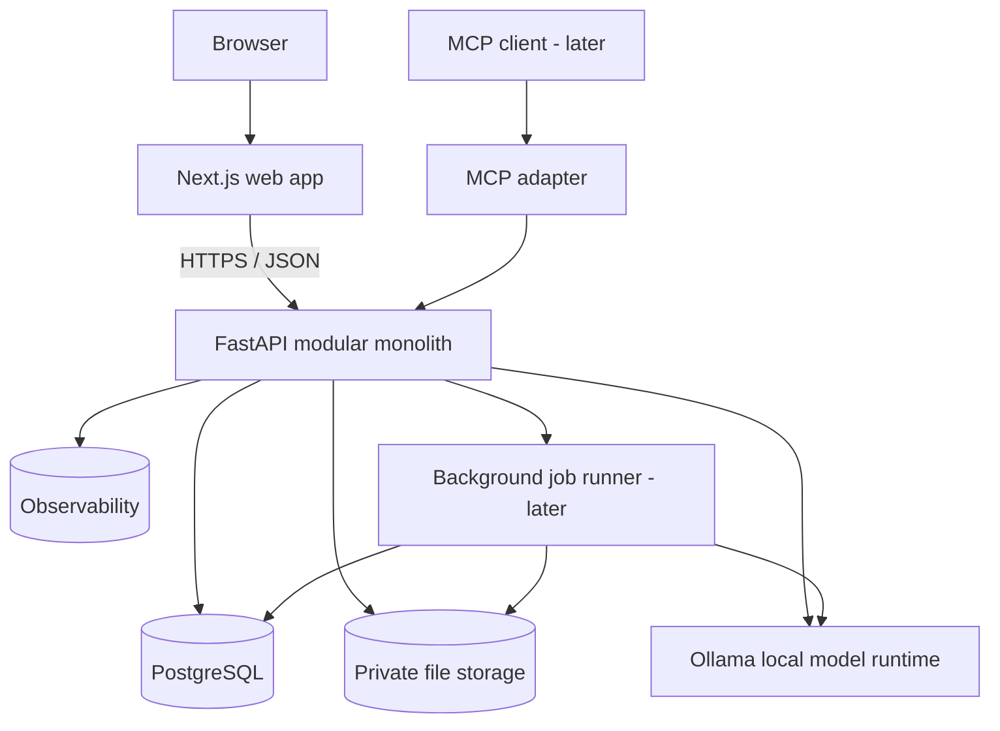

# Architecture — Modular Monolith with Clear Boundaries

## Context / deployment

All arrows represent logical calls; deployment boundaries and auth policies are chosen per phase. Keep the MCP interface separate from public HTTP endpoints; it delegates to the same authorized application services.

## Backend bounded modules (one deployable)
- `identity`: user authentication, sessions, ownership context.
- `properties`: properties, meter metadata and status.
- `readings`: ingestion, ordering, resets/replacements, validated intervals.
- `billing`: bill cycles, verified invoices, reconciliation, tariff engine.
- `documents`: uploads, safe storage, extraction jobs, review state.
- `analytics`: aggregations, baselines, forecasting, anomaly detection.
- `ai`: model-provider interface, grounded answers, retrieval, evaluation adapters.
- `agent`: tool registry, policy checks, controlled agent execution, MCP adapter.
- `platform`: database connection, configuration, audit, telemetry, cross-cutting concerns.

## Dependency rule
HTTP routes -> application use cases -> domain policies -> repository interfaces -> infrastructure adapters. Internal module API calls, not direct cross-module table writes. Avoid unnecessary layers until a concrete test demonstrates their benefit.

## Typical code layout (target, not day-one scaffold)
```text
backend/
  src/energyiq/
    main.py
    platform/
    identity/
    properties/
    readings/
    billing/
    documents/
    analytics/
    ai/
    agent/
  tests/unit/ tests/integration/ tests/contract/
  alembic/
frontend/
  app/ components/ lib/ tests/
infra/
  compose.yaml
sample-data/
docs/
```

## Data flow A — Manual meter reading
Authenticated user -> validate ownership/meter state -> validate reading timestamp and cumulative value -> store immutable observation/audit entry -> recompute affected adjacent intervals with reset rules -> return status + calculated intervals -> dashboard reads aggregates. Reject invalid assumptions rather than overwrite silently.

## Data flow B — Bill extraction
Upload -> MIME sniff/signature check, size limits, sanitized file name, private storage -> queue extraction job -> PDF text where available or tested OCR/vision path -> Ollama or extraction adapter proposes structured fields -> schema/cross-field validation + provenance -> reviewer fixes/confirms -> persist verified invoice -> reconcile with meter intervals. **Unconfirmed model values never become authoritative financial data.**

## Data flow C — AI question
Authenticated user -> authorize requested property scope -> classify question / select safe tools -> read verified metrics from application services and retrieve permitted documentation -> create constrained evidence package -> model responds with source references -> server checks output schema and citation IDs -> display answer + evidence + uncertainty/abstention. Do not ask LLM to calculate bill totals.

## Data flow D — Model evaluation
Curated dataset -> pinned prompt/model version -> run local inference -> store outputs/metrics with dataset revision, latency, tokens where available -> inspect failures -> promote prompt/model only when no significant regressions.

## Reliability notes
- Store UTC instants and preserve original timezone/date context; midnight boundaries in Santo Domingo matter.
- Concurrency: choose transaction/isolation design for reading inserts and recomputations; test duplicated requests.
- Store document upload metadata and processing state separately from confirmed billing entities.
- Keep time-series in PostgreSQL initially; no TimescaleDB required by default.
- Async endpoints do not make CPU/LLM inference nonblocking by themselves: use a background worker when needed, with resource limits.
- Use exact pgvector search initially; approximate HNSW only after performance data justifies index cost.

## Deployment evolution
Follow the implementation roadmap: P0 foundations/CLI -> P1 reading-history domain -> P2 FastAPI + PostgreSQL + auth -> P3 Next.js UI -> P4 bill intelligence -> P5 forecasting/anomaly -> P6 RAG/assistant -> P7 agents/MCP -> P8 production hardening. Local Compose; optional isolated cloud deploy only once secrets, encryption, backups, file storage and health checks are in place.
